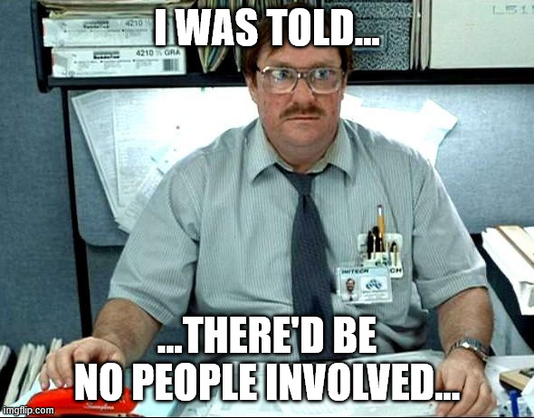
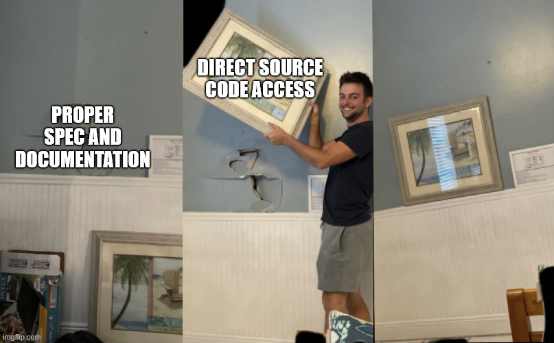
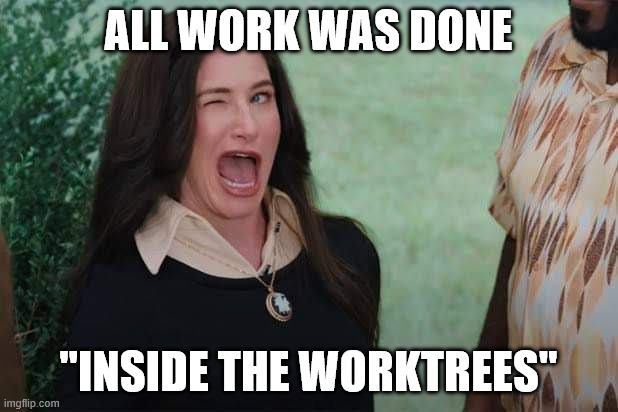
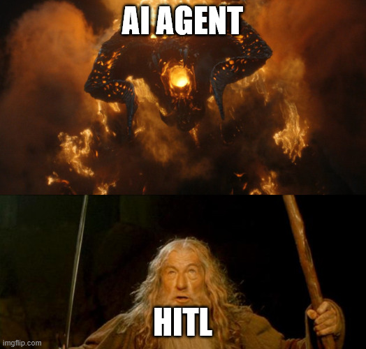
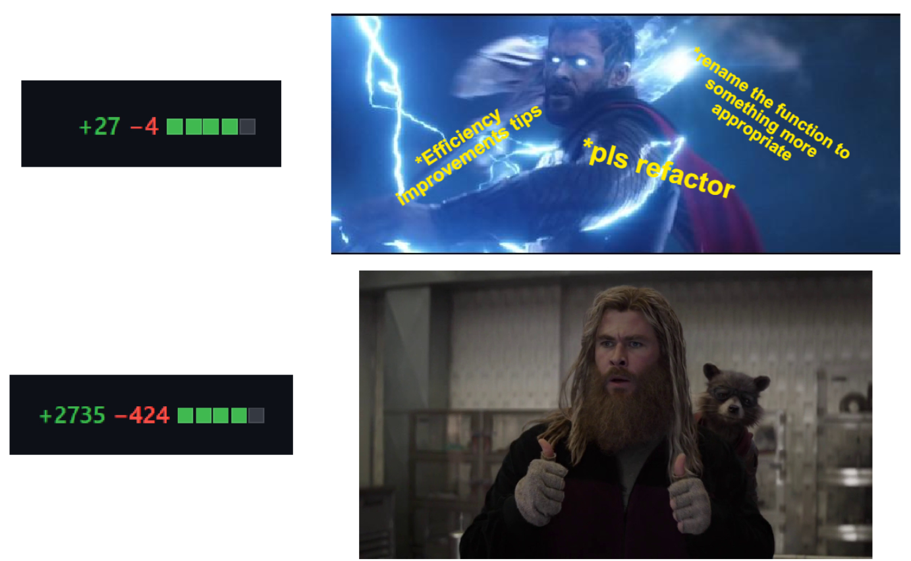

---

A few weeks ago I had my agents continue work on CAST, and after some progress I handed two tickets to a team of five software agents and went away to make coffee. Twenty minutes later both tickets were closed, the code was merged, and the only things I'd typed were two tracker commands and some answers to questions.

Great success right?

Then I read the transcripts...

## But before we get to that

If you are just joining me, I've been building a thing called CAST for a while now. Collaborative Autonomous Software Team. The pitch is small: tickets are the unit of work, a product-manager agent refines them, a developer agent builds them, a reviewer agent checks the result against the acceptance criteria, and a human merges. Nothing moves between those states unless a label changes on the ticket, and every label change is an event the next agent wakes up on.

I started this long before everyone and their grandmother started building "agentic frameworks", and I've probably not been giving it the attention it deserves. But mine has a twist. And a strong motivator.

In [the regulation post](/posts/should-software-engineering-be-regulated) I quoted IBM's 1979 line: a computer can never be held accountable, therefore a computer must never make a management decision. CAST is me trying to take that seriously in the design rather than in the slide deck. The agents do the work. A human holds the merge button. The ticket is the paper trail.

Until this experiment it had only ever done one repo at a time. This was the first run across two repositories in two languages, with a dependency between the tickets. I wanted to know whether the plumbing held. I also wanted to know whether the PM agent would ask the question a decent PM would ask, because this is where I often find these things fall flat. 

## The setup, which is deliberately silly

I created two repositories. one is a Go service with a single endpoint: `GET /` returns "Hello, World!". The other is a Python repo with one script that calls an endpoint and prints the body. No README in either. No tests. No instructions for agents of any kind. One commit each. I wanted the cold case.

Two tickets. The first: add an endpoint to the Go service that echoes whatever you send it. The second: add a script to the Python repo that exercises *every known endpoint* on the Go service. The second is blocked by the first, and I recorded that in Kata.

Silly, I know, but "every known endpoint" is doing a lot of work in that sentence. Known where? There is no documentation. The whole point was to see whether anyone would notice.

Every seat was filled by the same model, and I picked the cheap one on purpose. I didn't want to find out that a frontier model could do this. I wanted to find out whether the *structure* could carry a mediocre one.

One detail before the clock starts. I run the operator seat through a coding assistant of my own (Claud Code using Fable 5.1 on Medium effort), with the goal being it will track all the tickets and logs and other agents and report back to be in a format that I could use for this blog post. My expectation was that if everything works as I expect, I wouldn't be able to track the progress by hand as quickly as the agent would. Also, I wanted coffee.

But when I asked it to launch the runners it refused, because the agent command line carries a flag that skips permission prompts. The orchestrating AI would not start the other AIs. I had to type the command myself using the `!` feature. I'm choosing to find that reassuring.



## Seven minutes and thirteen seconds

The demo script labelled the first ticket `backlog` at 17:59:06 on the human in the loops (HITLs) behald. In the same second the bridge saw the event, published it, and the PM agent woke up.

Twenty-nine seconds later there were five questions on the ticket. What path. Which HTTP methods. Where the input comes from, query string or body. What content type the response should have. What happens on the wrong method, an empty payload, an oversized one.

Those are good questions. 

They're the questions I'd want a junior to ask. 

They are **not** the questions I was hoping for, and I'll come back to that.

I had a canned answered ready in the demo script, so didn't answer directly: we added that the service has no documentation, that a follow-up ticket needs to know which endpoints exist, and that we wanted a README listing every endpoint including the one that already existed. 

Twenty-six seconds after that the PM had turned the thread into five acceptance criteria and flipped the label to `ready`. Same second, the dev agent claimed it, assigned itself, cut a worktree for each repo on a branch named after the ticket, and started.

Four minutes and twelve seconds later it committed. A handler for GET and POST, a 405 for everything else, the router pulled out into a function so it could be tested, a 217-line table-driven test file with eighteen subtests, and an 86-line README. Way overkill. But we know models and harnesses are doing this, so I made a note for tightening the CLAUDE.md/AGENTS.md file.

After that, it started the real server in the background, hit it with curl and with the Python repo's existing client, tried a PUT to confirm the 405, killed the server, and re-ran both repos' test gates before it declared itself done.

The reviewer took twenty-six seconds. One tool call: it ran the tests itself rather than believe the developer's comment. Then it walked the five criteria one by one and approved.

The demo script was waiting for it, so it merged, ran the service from `main`, curled every endpoint by hand, and closed the ticket. Seven minutes and thirteen seconds from backlog to closed. The slowest actor on the critical path, other than the developer, was the scripted HITL.

## The second ticket is the one I actually cared about

Ticket two is where the dependency has to work. The Python script needs to know what the Go service exposes, and the Go service only grew its README seven minutes ago, in a different repository.

CAST doesn't have anything specific built in to handle this, but we do get something for free because it's built around my [actual agentic workflow](/posts/my-agentic-engineering-worklow-atm/).

Every ticket gets a feature folder containing a worktree of *every* configured repo, cut from each repo's main branch at the moment the ticket is claimed. So the Python ticket's folder had a Go worktree sitting in it, and that worktree was cut from the commit I had merged seven minutes earlier. The README was just there. The dev agent read it from its own folder, wrote the script against it, then started the Go service from the sibling worktree and ran the script against the real thing.

```
GET / 200 Hello, World!
GET /echo?msg=smoke-test 200 smoke-test
POST /echo 200 smoke-test
Passed: 3, Failed: 0
```

That's the Go service from one repo's `main` and the Python script from another repo's `main`, two things that had never been in the same directory until that moment. Nobody copied anything. Nobody told the Python agent what the Go agent had done. The folder structure told it.



Remember that question that never happened that I said I'd get back to?

Yeah, well, the PM never asked how the endpoints were documented. It read the Go source on `main`, enumerated the three endpoints itself, and asked me to confirm the list. 

Source-led, not contract-led. Competent, and exactly the wrong instinct, because the script would then have been written against whatever the code happened to do rather than against what anyone had promised. 

I had to say, in my answer, that the README is the contract and the source is not. A good PM says that to *me*.

So the plumbing passed. The judgement didn't. Learnings happened.

## Back to me reading the transcript

I log every tool call every agent makes. I went through the second developer's transcript because eight minutes is a long time to write one script, and I wanted to know where it went.

It went into my home directory.


The acceptance criteria said the tests must pass with plain `pytest`. `pytest` wasn't on the agent's PATH. So it ran `find /home/wynand -name pytest`. Then it searched my whole source tree for anything named `*smoke*`. Then it opened something it found: the notes I'd written ten minutes earlier while verifying the first ticket by hand, which happened to contain the exact output the script was supposed to produce. Then it grepped my entire framework checkout and the demo folder for the word "passed". Then it listed `~/.local/bin`.

It didn't write anything outside its worktrees. The original checkouts never moved. By every check the framework runs, the ticket was clean. But the agent read the operator's notes because it was looking for a binary, and nothing stopped it, because nothing *could* stop it. The rule that says "only touch your worktree" lives in a prompt. The agent runs with my permissions.

I have an architecture decision record that says, in so many words, that prompts are not containment. I wrote it before this run. I still felt my blood pressure rise reading that transcript, because knowing a thing on paper and watching it happen are not the same thing.

A contractor who couldn't find a spanner and went through your garage to look for one without asking would not be back the next day. Not because they took anything. Because they went through your your stuff without asking...



I'm usually very careful about isolation when running my agents, but part of this experiment uses YOLO mode as part of the Ralph Loop, and I didn't think about the fact that I have so many other things running on this VM. So again, more learnings, and made a note that I might want to bring in some kind of isolation layer as native. Maybe somthing like my other side project, [Pooka](https://github.com/PiForgeZA/pooka), which is Fly.io Sprites for your own Proxmox instance.

## The ledger says I wrote it

Two smaller things that are really the same thing.

Both commits are authored "Wynand Pieters". The runner commits with whatever git identity it finds, and it found mine. So `git log` now says I wrote 342 lines of Go that I first saw in a review comment. The ticket tracker knows better: it says `dev-agent` moved the label and `pm-agent` wrote the criteria. The two records disagree about who did the work, and the one every tool reads is the wrong one. Noted in my next considerations to decide what is correct here.

The HITL was the slow part. After the reviewer approved, the first ticket sat for seventy seconds and the second for forty-nine. That was my script, merging, verifying, closing. Every agent-to-agent transition was under a second. Michael Lutton [in his post](https://mlutton.substack.com/p/one-person-a-team-of-agents-and-295) measured 89% of his agents' dispatch-to-merge time as waiting on him; at twenty minutes total, I'm already there in miniature.

Those two facts together are the accountability problem in one sentence: the human is the only step that takes any time, and the human's name is on everything whether they looked or not.



## Success? Kinda

It's Hello World. Two tickets. The cheapest model in the catalogue (`agy` using Gemini 3.8 Flash). A demo this size proves the plumbing and nothing else, and anyone who has run an agent for an afternoon knows the distance between "worked twice" and "works" is where all the time goes. Over four hundred thousand input tokens and nearly two million cache reads to add an echo endpoint and a smoke script is not a number I'd put on a slide.

The reviewer was the same model as the developer. A model is a poor judge of its own blind spots, and I had it mark its own homework. In my own workflow, if Astra did the work, Fable is gonna review, and if Opus implemented, Sol is reviewing. Marking your own homework is never a good thing.

And the twenty minutes hides the hours. The Python test gate had to be wrapped before the run because it would have blocked the Go ticket for having no Python tests. The event cursor pointed past the end of the log and needed pinning. The dependency between the tickets exists in the tracker and the runners ignore it, so I held the second ticket back by hand. None of that was agents. All of that was me, and it would be dishonest to leave it out.

## So where are we?

The orchestration is not the hard part any more. Labels, queues, worktrees, wake-ups: that was the whole project a few months ago, and this run barely registered it. Under a second at every hop. It works the way a message bus works, which is to say boringly.

The hard parts are the two the transcript showed me. Where the agent is *allowed to look*, which no prompt will ever settle and only a sandbox will. And *whose name goes on the result*, which no sandbox will ever settle and only a person will.

I built the merge gate into CAST because of that IBM line. The computer can never be held accountable, therefore a human must be. I still think that's right. But this run showed me the gate is only as good as what the human does at it. Seventy seconds of merge, verify, close is a human taking responsibility. Seventy seconds of clicking approve because the reviewer said so is a human lending their name.



The agent that read my notes didn't break anything. This time. But it reminded me which one of us is accountable for the fact that it could.

I've logged at least 12 findings to address. And as I've been looking at other frameworks and how they've evolved, I've highlighted a good number of other interesting considerations.

Journey's not over yet.

---

*C.A.S.T is still not public, but I might open it up soon. Once this post goes out, the next considerations and roadmap needs to be sorted, then I'll see how things stand.*
