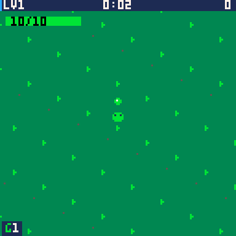

I read a post on the Haskell Discourse this week that I haven't been able to stop thinking about. It's called [How to keep enjoying programming in a world of LLMs](https://discourse.haskell.org/t/how-to-keep-enjoying-programming-in-a-world-of-llms/14705), written by a developer who goes by turion, and halfway through I had that slightly uncomfortable feeling of reading something I could have written. Or at least, something I've been circling for months without quite landing on.

Go read it. It's long, it's thoughtful, and it's (by the author's own declaration) 100% human written. Which, these days, is worth mentioning.

## The Short Version

Turion loves writing Haskell. Not just the product, not just the output. The actual act of expressing thoughts in the language. And they noticed that when an agent generates the code, that enjoyment goes with it.

So their answer is to flip the usual agent workflow on its head. Everyone's selling "plan with the agent, then let the agent code." Turion says: plan together, then **you** code. Let the agent do the bookkeeping. The research. The todo lists. Pointing out every place in the codebase you'll need to touch. The review cycle afterwards. But the code itself? That's yours.

Their reported productivity gain? Roughly double. Not 10x. Not 100x. Double. And they're fine with that, because they get to keep enjoying their job.

I appreciate that number more than I can say. For months I've been asking LinkedIn for receipts on the "100x more productive" claims and the response?

Here's someone saying "about 2x, and I still like my work." That's the most believable productivity claim I've read all year.

## I Got Here From the Other Direction

Back in March I wrote about [rediscovering when coding was fun](https://wynandpieters.dev/posts/rediscovering-when-coding-was-fun/). The short version: I got fed up with Unity, paused *So This Is How I DIE*, picked up PICO-8, and told my brother something I've been unpacking ever since:

> *i get to think for myself a bit.*

That line is basically turion's entire post, compressed into one throwaway WhatsApp message.

But here's the thing. We found the same problem and went in completely different directions to solve it.

My answer was to step **outside**. Find a tiny, constrained, transparent machine where every token and every pixel is a decision I made. No agents, no pipelines, no HDR, no abstraction layers. Recovery from the day job.

Turion's answer was to stay **inside**. Keep using LLMs professionally, keep the productivity gain, but restructure the workflow so the human stays the coder.

And I think both are right. They're just answering different halves of the same question:

- How do you **protect** the joy at work?
- How do you **recover** it when work has already eaten it?

If you only do the second one, you end up treating your hobbies as therapy for a job that's slowly hollowing you out. If you only do the first one, you might not notice how much you've already lost until you try writing something from scratch and realise it's harder than it used to be. Turion makes this point too: a few weeks of handing everything to agents, and coming back to coding yourself gets noticeably harder. Skills you don't practise fade. [Fundamentals matter](https://wynandpieters.dev/posts/fundamentals-matter/), and you can't keep them by reviewing someone else's diffs.

## Okay, Here's Where I Have to Be Honest

My blog post right after the PICO-8 one was [The Future of AI Coding is Directing](https://wynandpieters.dev/posts/cast-intro/). Where I introduced C.A.S.T. and talked about applying team lead principles to agents. Specs, tickets, kanban, PRs, the whole SDLC, run by a cast of agents with me in the director's chair.

Turion's post is, in a lot of ways, an argument against exactly that. Refuse the "plan first, let the agent code" model. Stay the coder.

So which is it, Wynand? Am I the director, or am I the guy in his PICO-8 cave thinking for himself?

I've thought about this a lot, and I don't think it's actually a contradiction. But it is a tension, and pretending otherwise would be dishonest.

Remember DHH's line about his career being ["CRUD monkeying"](https://x.com/dhh/status/1956632934615490574)? I still think that's true for about 80% of software. And for that 80%, directing agents makes sense. Nobody's falling in love with their fourteenth REST endpoint. Let the agents do it, review it, ship it.

But the other 20% is where the interesting problems live. The architecture. The tricky state management. The bits where you have to hold six things in your head at once. The parts that made most of us fall in love with this job in the first place. That's where I want to be the coder. That's where turion's workflow makes the most sense to me.

And here's the part that ties it together: **you can only direct well if you're still a programmer worth listening to.** A director who's forgotten how to act gives terrible notes. A team lead who hasn't written code in five years starts making decisions that sound fine in a meeting and fall apart in the codebase. If directing agents is the future, then staying sharp at the actual craft isn't nostalgia. It's the job requirement.

So maybe the answer is: direct the 80%, code the 20%, and keep a tiny fantasy console nearby for when you forget why you started.

## And Then DHH Changed His Mind

I should be upfront: the "CRUD monkeying" line I keep quoting is from DHH's Rails World 2025 keynote. A year later, he's in a very different place.

At Rails World 2026, he announced that 37signals has gone "pencils down" on hand-written code. Agents write the code. Hand-writing it is treated as an exception, like an error in Sentry, a sign the agent harness needs fixing. In his five-hour round two with Lex Fridman, he said agents wrote all of the latest release of Omarchy, his Linux distro, and that writing code by hand is no longer an economically viable skill for most programmers at most companies.

That's about as far from "plan together, then you code" as you can get. So either turion and I are clinging to the past, or something else is going on.

Here's what I find interesting, though. In the same interview, he admitted the agents had a much harder time on Basecamp and HEY, the decade-old products that actually pay the bills. And an early experiment letting designers vibe-code the last features of Basecamp 5 reportedly left the architecture like Swiss cheese.

So the greenfield distro went great. The long-lived production codebase was harder. The leaky abstraction leaked exactly where you'd expect.

And to be fair, I've asked "where are the new operating systems?" more than once. Omarchy isn't a new kernel or a new set of GPU drivers. It's an opinionated layer on top of Arch. But it's closer to an answer than anything I'd seen when I first asked, and I'd be a hypocrite not to say so.

What I keep coming back to is this: DHH can go pencils down because he spent over twenty years with the pencil. He knows what good Rails looks like better than almost anyone alive, so when an agent writes bad Rails, he notices. That's the "programmer worth listening to" point from earlier. It doesn't really argue against staying sharp. If anything, it's the best argument for it.

He also called this software's Kodak Brownie moment, and told people not to "black pill" it. I'm not black-pilling it. I use agents every day. But I've already written about why "this is just like the printing press" analogies skip over the people who don't make it through the transition. And feeling hollow after a day of directing agents isn't despair. It's information. It's worth paying attention to, not shouting down.

## A Few Other Bits Worth Stealing

Turion's post has a bunch of ideas I want to borrow, so I'll flag a few:

**Running out of tokens is a service outage, not a personal failure.** I've ranted about token costs and token-saving plugins that don't save tokens. This reframe is better than anything I came up with. If you build your workflow around a tool and the vendor quietly changes how much of it you get, that's not you "buying too few". That's the tool going down. Plan for it like you'd plan for no wifi on a flight.

**Don't send people LLM-written PR descriptions as if they're communication.** Treat them as tool output, attached under your own human summary. This lines up with what I wrote about [prompting LLMs and ignoring the human API](https://wynandpieters.dev/posts/prompting-humans-vs-llms/). We're getting better at talking to machines and worse at talking to each other. This is a small, practical way to push back.

**You're responsible for your code, not your machine.** Same conclusion I reached with the old IBM "a computer can never be held accountable" quote. If you can't take responsibility for the output, you're using the tool wrong.

## So, erm... yeah

I'm not throwing away C.A.S.T. I'm not throwing away agents. I use them every day, and I'll keep using them. I've been having some incredible fun with Fable 5.1 and side-projects I've long ignored, so they'll remain part of my toolbox.

And I'm going to be more deliberate about which parts of the work I hand over, and which parts I keep. Not because I'm scared of being replaced. Because I like this job, and I'd quite like to keep liking it.

I'm hoping you read the post when I asked you too (if not, go do it now). Then go read the comments, because there's a good counterpoint in there from someone who has the *opposite* experience, and finds LLMs have made programming more fun by taking the grunt work away. That's a valid experience too. It depends. It always depends.

And if you're feeling hollow at the end of your AI-assisted workday? Go make a tiny game. Think for yourself a bit.

